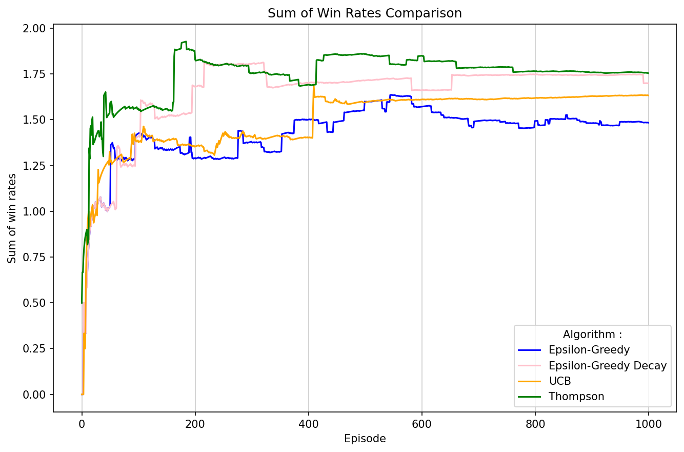
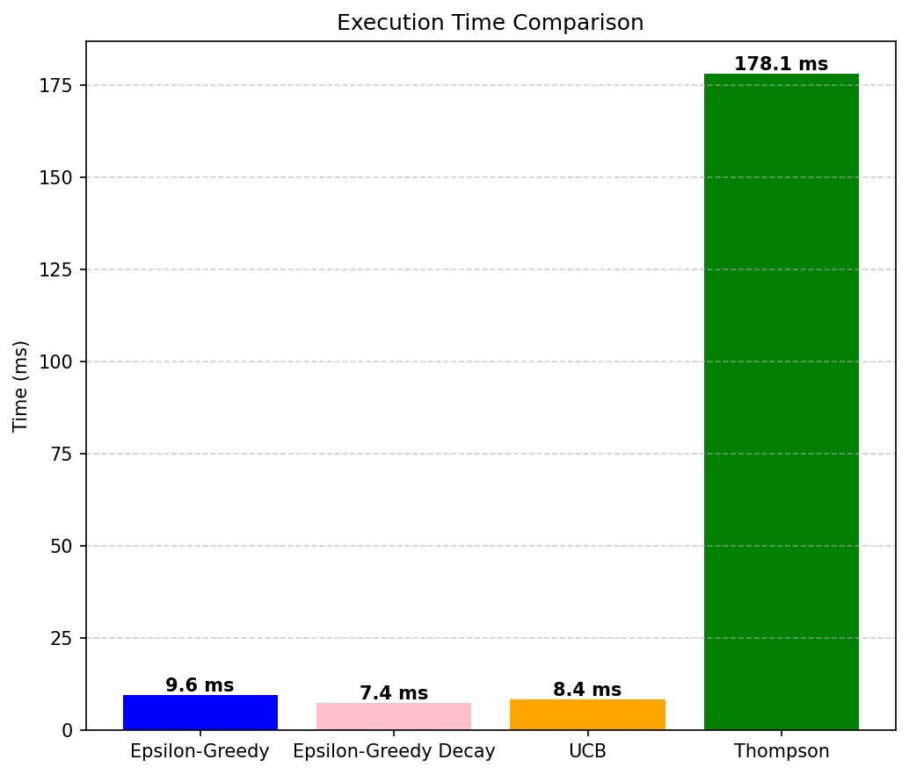
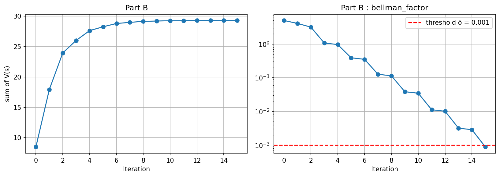
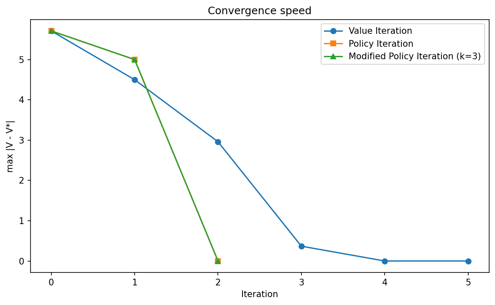
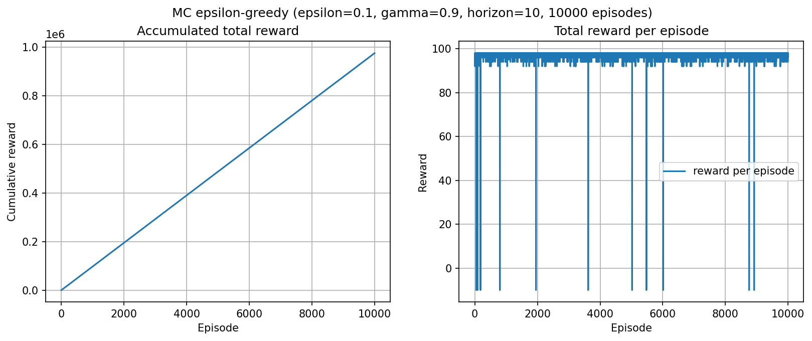

# Reinforcement Learning: from bandits to Monte-Carlo

Coursework from the Reinforcement Learning course at NTNU (Taiwan), taken during my exchange semester at NTUST, fall 2026. Implemented in Python (NumPy, Matplotlib, SciPy). The goal is to compare classic reinforcement learning algorithms on small problems, in terms of convergence speed and computation cost.

## Contents

| Folder | Problem | Algorithms | Main takeaway |
|---|---|---|---|
| `01_bandits/` | 4-armed bandit (p = 0.5, 0.1, 0.8, 0.3), 1000 steps | Epsilon-greedy, epsilon-greedy with decay, UCB, Thompson Sampling | Thompson Sampling collects the most wins (803/1000) but is about an order of magnitude slower than the others |
| `02_dynamic_programming/` | 8-state MDP, dense vs sparse rewards | Value Iteration | With a dense reward the agent loops with the "back" action instead of finishing; with a sparse reward, convergence (δ = 0.001) takes 15 iterations |
| `02_dynamic_programming/` | 9-state MDP | Value Iteration, Policy Iteration, Modified Policy Iteration | PI and MPI converge in 2 iterations, VI in 5, but one iteration does not cost the same for each method |
| `03_monte_carlo/` | 4x6 grid world with walls and two jump actions | Monte-Carlo epsilon-greedy (every-visit) | The greedy policy reaches the target from S20 using a jump, with a total reward of 98 |

## Results

### Multi-armed bandits




Total wins over 1000 steps (seed 20, single run):

| Algorithm | Wins | Time |
|---|---|---|
| Thompson Sampling | 803 | ~100-180 ms |
| Epsilon-greedy with decay | 787 | ~5-7 ms |
| UCB | 778 | ~8-9 ms |
| Epsilon-greedy | 746 | ~7 ms |

Thompson Sampling is the slowest because it draws a Beta sample for every arm at each step. Decreasing epsilon over time improves epsilon-greedy at a similar computational cost. Times depend on the machine.

The plot shows the sum of per-arm win rates. This metric rewards exploration (an algorithm that only played the best arm, p = 0.8, would score about 0.8, while one that samples every arm approaches 1.7), so the total number of wins above is a fairer measure of performance. With a single seed, the gaps between algorithms are small and should not be over-interpreted.

### Value Iteration

Dense reward (a reward in every state): the optimal policy picks the "back" action in 4 of the 7 non-terminal states. Because intermediate states give positive rewards, the agent maximises its long-term return by looping between them rather than reaching the terminal state S8.

Sparse reward (+5 only in S8):



The sum of state values grows quickly and reaches a plateau around iteration 10-12, as the single reward propagates backwards to all states. The maximum update per iteration decreases geometrically and falls below δ = 0.001 at iteration 15.

### Value, Policy and Modified Policy Iteration



Policy Iteration and Modified Policy Iteration (k = 3 evaluation steps) converge in 2 iterations on this problem, Value Iteration in 5. These counts are not directly comparable, since one PI iteration includes a full policy evaluation.

### Monte-Carlo epsilon-greedy



Parameters: epsilon = 0.1, gamma = 0.9, horizon = 10, 10,000 episodes, fixed start in S20.

The learned greedy path goes from S20 to S2 with the jump action, then two steps left to the target (total reward 98). Over the last 500 episodes, the mean reward is about 97.5, which shows the policy has converged even with epsilon = 0.1 exploration. Episodes with a negative total reward are exploration phases where the agent does not reach the target within the horizon.

## How to run

```bash
pip install -r requirements.txt

cd 01_bandits && python bandits.py && cd ..
cd 02_dynamic_programming && python value_iteration.py && python vi_pi_mpi_comparison.py && cd ..
cd 03_monte_carlo && python mc_epsilon_greedy.py && cd ..
```

Run each script from its own folder: figures are saved in `figures/` at the root of the project.

## Notes

- Random seeds are fixed for reproducibility.
- The Monte-Carlo implementation is based on the skeleton provided by the instructor, extended with the jump actions, the plots and the analysis.
- States rarely visited from the fixed start S20 have an essentially arbitrary action in the printed policy.
- Results come from a single run per script.

## Tech

Python 3, NumPy, Matplotlib, SciPy
